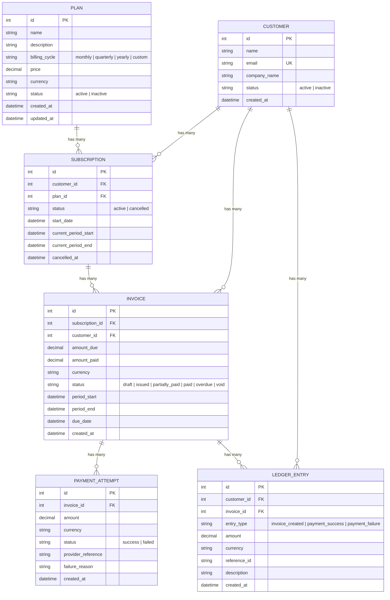
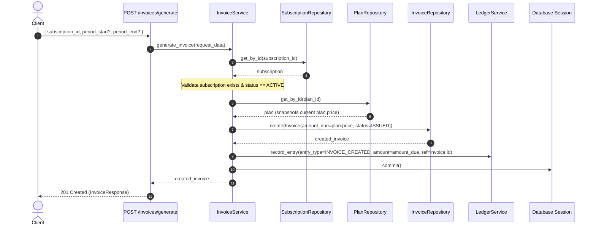

# Low-Level Design (LLD): SubLedger — SaaS Subscription & Billing System

---

## 1. Entity Relationship Diagram (ERD)



---

## 2. Service Responsibility Matrix

| Service | Logic It Owns | What It Must NOT Do |
|---|---|---|
| **`PlanService`** | Validates price ($> 0$), validates billing cycle, manages plan activation and deactivation. | Directly manipulate invoices, subscriptions, or ledger entries. |
| **`CustomerService`** | Creates customers, enforces unique normalized email check, fetches profile data. | Execute payment operations or alter billing records. |
| **`SubscriptionService`** | Creates and cancels subscriptions, checks plan active status, prevents duplicate active subscriptions to the same plan. | Generate invoices directly or touch ledger records. |
| **`InvoiceService`** | Generates invoices, snapshots plan price at time of generation, calculates billing period, **updates invoice status and paid balance after payment** (`apply_payment`). | Directly process raw payment attempts or handle external gateway responses. |
| **`PaymentService`** | Records payment attempts, validates payment amount $\le$ remaining unpaid balance, **triggers invoice status update via `InvoiceService`**, and calls `LedgerService` for audit logging. | Mutate invoice fields directly without delegating to `InvoiceService`. |
| **`LedgerService`** | Creates append-only ledger entries for events (`invoice_created`, `payment_success`, `payment_failure`) and queries customer audit history. | Expose any mutation or deletion operations. Ledger is strictly append-only. |

---

## 3. Repository Responsibility Matrix

| Repository | Entity Read/Written | Common Methods | Architectural Safeguards |
|---|---|---|---|
| **`CustomerRepository`** | `Customer` | `create()`, `get_by_id()`, `get_by_email()`, `list()` | Uses `flush()` and `refresh()`; isolates DB session from route layer. |
| **`PlanRepository`** | `Plan` | `create()`, `get_by_id()`, `list()`, `update()` | Handles plan state and metadata persistence. |
| **`SubscriptionRepository`** | `Subscription` | `create()`, `get_by_id()`, `get_active_by_customer_and_plan()`, `list()`, `update()` | Backed by `uq_active_customer_plan` composite partial unique index preventing duplicate active subscriptions at DB level. |
| **`InvoiceRepository`** | `Invoice` | `create()`, `get_by_id(for_update=True)`, `list()`, `update()` | Supports `with_for_update()` pessimistic row locking to prevent concurrent double-payments. |
| **`PaymentAttemptRepository`** | `PaymentAttempt` | `create()`, `get_by_id()`, `get_by_provider_reference()`, `list_by_invoice()` | Provides idempotency lookups to prevent duplicate gateway transaction replays. |
| **`LedgerRepository`** | `LedgerEntry` | `create()`, `get_by_id()`, `list_by_customer(entry_type=...)`, `list_by_invoice()` | **Append-Only Enforcement**: Does **NOT** provide `update()` or `delete()`. Any attempted call raises `NotImplementedError`. |

---

## 4. Business Rule Ownership Matrix

| Business Rule | Primary Enforcement Layer | Secondary / Storage Guard | Implementation Detail |
|---|---|---|---|
| **1. Plan price must be $> 0$** | `PlanCreate` Schema | `PlanService` validation | Rejected at API boundary (`price <= 0`) and validated in domain service. |
| **2. Customer email must be unique** | `CustomerService` | `Customer.email` DB Unique Index | Service performs normalized lowercase uniqueness lookup; DB enforces unique constraint. |
| **3. A subscription cannot be created for an inactive plan** | `SubscriptionService` | `Plan.status` check | Checks `plan.status == PlanStatus.ACTIVE`; raises `BusinessRuleException` if inactive. |
| **4. No duplicate active subscriptions to same plan per customer** | `SubscriptionService` | `uq_active_customer_plan` DB Partial Unique Index | Service performs check; DB enforces composite partial unique index (`customer_id, plan_id WHERE status IN ('ACTIVE', 'active')`) to eliminate race conditions. |
| **5. Invoice amount due snapshots plan price at generation** | `InvoiceService` | `Invoice.amount_due` immutable column | Read `plan.price` upon generation and write snapshot to invoice; future plan price changes do not alter existing invoices. |
| **6. Successful payment cannot exceed remaining unpaid balance** | `PaymentService` | `remaining = amount_due - amount_paid` check | Validates `payment.amount <= remaining`; raises `BusinessRuleException` on overpayment. |
| **7. Invoice status moves to `paid` or `partially_paid`** | `InvoiceService.apply_payment` | `InvoiceStatus` enum transitions | If `new_paid >= amount_due` $\rightarrow$ `paid`; otherwise $\rightarrow$ `partially_paid`. |
| **8. Failed payment does not increase `amount_paid`** | `PaymentService` | Transactional branching | On failure, `Invoice.amount_paid` remains untouched; records failure reason and logs `payment_failure` ledger entry. |
| **9. Ledger entries are append-only and traceable by `reference_id`** | `LedgerRepository` | `LedgerService` | `LedgerRepository` blocks `update()`/`delete()`; logs `invoice.id` or `provider_reference` in `reference_id`. |
| **10. Payment currency must match invoice currency** | `PaymentService` | Currency code equality assertion | Validates `data.currency.upper() == invoice.currency.upper()`; prevents currency mismatch. |
| **11. Payment idempotency prevents duplicate gateway transaction replay** | `PaymentService` | `PaymentAttemptRepository.get_by_provider_reference` | If a successful payment with the same `provider_reference` exists, rejects re-recording with `409 Conflict`. |
| **12. Overdue invoice lifecycle progression** | `InvoiceService.check_and_update_overdue` | Automated batch transition (`POST /invoices/mark-overdue`) | Evaluates if `due_date < now` for unpaid invoices and transitions status to `InvoiceStatus.OVERDUE`. |
| **13. Concurrency protection on payments** | `PaymentService` | `InvoiceRepository.get_by_id(..., for_update=True)` | Employs `with_for_update()` pessimistic row locking on `Invoice` to serialize concurrent payment requests and prevent double-payments. |

---

## 5. Design Patterns Rationale

### 1. Repository Pattern
- **Why**: Decouples domain logic from SQLAlchemy ORM queries and database engines.
- **Benefit**: Allows the service layer to operate on clean domain models without embedding query syntax. Facilitates testing with in-memory SQLite fixtures without modifying service code.

### 2. Service Layer Pattern
- **Why**: Encapsulates end-to-end business workflows and transactional boundaries away from FastAPI routes.
- **Benefit**: Ensures API route handlers are thin controllers that solely parse HTTP requests and format HTTP responses. Pure domain exceptions (`NotFoundException`, `BusinessRuleException`, `ConflictException`) are raised by services, keeping business logic 100% decoupled from HTTP status codes.

---

## 6. Core Flow Implementations

### Flow A — Invoice Generation Flow



### Flow B — Payment Recording Flow

```mermaid
sequenceDiagram
    autonumber
    actor Client
    participant Route as POST /payments/record
    participant PS as PaymentService
    participant IR as InvoiceRepository
    participant PAR as PaymentAttemptRepository
    participant IS as InvoiceService
    participant LS as LedgerService
    participant DB as Database Session

    Client->>Route: { invoice_id, amount, status, provider_reference }
    Route->>PS: record_payment(payment_data)
    PS->>IR: get_by_id(invoice_id)
    IR-->>PS: invoice
    Note over PS: Validate invoice exists, payable, and amount <= remaining
    PS->>PAR: create(PaymentAttempt(status, provider_reference))
    PAR-->>PS: payment_attempt
    alt Payment Succeeded
        PS->>IS: apply_payment(invoice, amount)
        Note over IS: Update amount_paid, transition to PAID or PARTIALLY_PAID
        PS->>LS: record_entry(entry_type=PAYMENT_SUCCESS, amount, ref=provider_ref)
    else Payment Failed
        Note over PS: Do NOT increment amount_paid
        PS->>LS: record_entry(entry_type=PAYMENT_FAILURE, amount, ref=provider_ref)
    end
    PS->>DB: commit()
    PS-->>Route: (payment_attempt, updated_invoice)
    Route-->>Client: 201 Created (PaymentRecordResponse)
```
